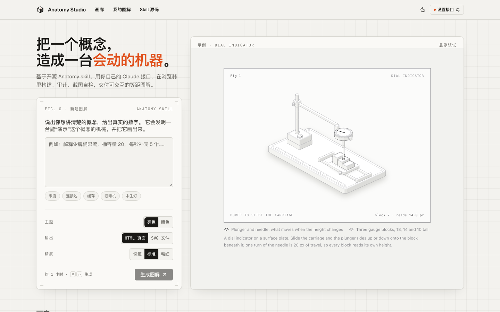

<div align="center">

# Anatomy Studio

**把一个概念，造成一台会动的机器。**

在浏览器里运行开源 [Anatomy skill](https://github.com/wheresryan22/anatomy)，用你自己的 Claude 接口，生成可交互的等距（isometric）机械图解。纯静态，零后端。

[](https://github.com/MilkFoam-L/anatomy-studio/actions/workflows/ci.yml)
[](https://github.com/MilkFoam-L/anatomy-studio/actions/workflows/deploy.yml)
[](LICENSE)


[**在线使用**](https://milkfoam-l.github.io/anatomy-studio/) · [功能](#功能) · [快速开始](#快速开始) · [工作原理](#工作原理) · [部署](#部署) · [常见问题](#常见问题) · [赞助商](#赞助商) · [参与贡献](#参与贡献)

<sub>赞助商 · <a href="https://www.apophis.uk/"><b>ApophisCode</b></a> — 多模型接入，专注 AI 编程与应用开发</sub>

<picture>
  <source media="(prefers-color-scheme: dark)" srcset="docs/screenshot-dark.png">
  
</picture>

</div>

> **English** — Anatomy Studio is a static web app that runs the open-source Anatomy skill entirely in your browser. Bring your own Claude API key and endpoint (official or any relay), describe a concept, and get an interactive isometric diagram. No backend, no account, no data leaves your browser except the model requests you configure.

---

## 功能

用起来像「一键生图」，背后跑的是完整的 skill 工作流：构思物件 → 写几何 → 构建 → 几何审计 → 截图自检 → 修正。

| | |
|---|---|
| 🧱 **零后端** | 纯静态文件，部署到 GitHub Pages、Cloudflare Pages 或任意静态托管。请求从浏览器直接发往你填写的接口。 |
| 🔑 **自带接口** | 内置赞助商 ApophisCode 预设，也可以切到 Anthropic 官方或任意自定义站点。支持 Anthropic Messages（`/v1/messages`，推荐）和 OpenAI 兼容（`/v1/chat/completions`）两种协议。两套配置（地址、Key、模型）分开保存，切换时互不覆盖；可以从接口拉取模型列表。 |
| 🧪 **skill 原样运行** | 系统提示词直接用 `SKILL.md` 原文；`node build.mjs` 和 `--audit` 几何审计都在浏览器里真实执行，产物与本地 Node 逐字节一致（有 E2E 测试保证）。 |
| 📸 **浏览器内自检** | skill 原本用 headless Chrome 跑 `capture.mjs` / `drive.mjs` / `lines.mjs`，这里改为在页面内渲染和截图，参数不变，截图回传给模型。 |
| 🛡️ **安全隔离** | 生成的代码只在 opaque origin 的沙箱 iframe / Worker 中运行，读不到 API Key，也无法联网。 |
| ✏️ **继续修改** | 生成后可以直接提修改意见，在同一份上下文和工作区里接着改。 |
| 💾 **断了不丢** | 接口中途失败或手动停止时，保留已生成的最新页面，可以预览、下载，或点「继续」接着做。 |
| 🗂️ **本地历史** | 图解保存在浏览器 IndexedDB，可以重新打开、下载 HTML / SVG 和构建脚本。 |
| 🌗 **亮色 / 暗色** | 界面和生成的图解都支持两种主题。 |

## 快速开始

### 在线使用

1. 打开 **https://milkfoam-l.github.io/anatomy-studio/**
2. 点右上角「设置接口」，选择协议和服务商：默认预设赞助商 [ApophisCode](https://www.apophis.uk/)（填入 Key 即可用），也可以选「Anthropic 官方」或「自定义」填你自己的接口；填好 API Key 和模型后点「测试连接」
3. 描述想讲清楚的概念并给出真实数字（例如「令牌桶限流，桶容量 20，每秒补充 5 个」），点「生成图解」

> API Key 默认只存在当前标签页（sessionStorage）；勾选「记住」后才写入 localStorage。Key 只发往你填写的接口。

### 本地运行

需要 Node 22+。

```sh
git clone --recurse-submodules https://github.com/MilkFoam-L/anatomy-studio.git
cd anatomy-studio
npm install
npm run dev          # 打包 skill + 构建沙箱运行时 + 启动 Vite
```

### 常用脚本

| 命令 | 作用 |
|---|---|
| `npm run dev` | 本地开发服务器 |
| `npm test` | 单元测试（Vitest） |
| `npm run test:e2e` | 浏览器 E2E（Playwright）：构建一致性、审计、截图、布局 |
| `npm run build` | 类型检查并生产构建到 `dist/` |
| `npm run preview` | 预览生产构建 |

用真实接口跑端到端测试（会消耗额度，默认不跑）：

```sh
ANATOMY_BASE_URL=https://your-endpoint ANATOMY_API_KEY=sk-... npx playwright test live/job
```

## 工作原理

```
浏览器（静态站）
├─ Agent 循环 ─────────── 调用你的接口（/v1/messages 或 /v1/chat/completions，流式、自动重试）
│   system = 适配说明 + SKILL.md        tools = read/write/edit/list/grep/run/finish
│
├─ run "node work/x/build.mjs --light"
│   └─ 沙箱 iframe（opaque origin, CSP connect-src 'none'）
│       └─ Web Worker：虚拟文件系统 + node:fs/path/url 替身，import 改写为 blob URL，真实执行
│
├─ run "node scripts/capture.mjs page.html --hover 0.7,0.5"
│   └─ 检查台 iframe（opaque origin）+ 注入 agent：慢放时钟、合成指针/键盘事件、DOM 截图、线端检查
│
└─ 结果：沙箱 iframe 预览、下载、存入 IndexedDB
```

### 目录结构

| 路径 | 作用 |
|---|---|
| `vendor/anatomy` | skill 本体（git submodule），构建时打包成浏览器可读的只读文件系统 |
| `src/agent/` | 系统提示词、工具定义、Agent 循环、上下文压缩 |
| `src/llm/` | Anthropic / OpenAI 兼容协议、SSE 解析、重试 |
| `src/runtime/` | 虚拟文件系统、shell 解析、Node 运行时 Worker、文本工具（grep/head/sed…） |
| `src/stage/` | 检查台：截图、驱动、线端检查的浏览器实现 |
| `src/components/` | 界面（shadcn/ui on Base UI + Tailwind CSS v4） |
| `scripts/` | skill 打包、运行时构建、画廊缩略图 |
| `tests/` | 单元测试与 Playwright E2E |

### 技术栈

React 19 · TypeScript · Vite 8 · Tailwind CSS v4 · shadcn/ui（Base UI）· modern-screenshot · Vitest · Playwright

## 部署

`npm run build` 产出的 `dist/` 是纯静态文件。部署到子路径时设置 `BASE_PATH`：

```sh
BASE_PATH=/anatomy-studio/ npm run build
```

- **GitHub Pages**：仓库自带 `.github/workflows/deploy.yml`，推送到 `main` 后自动发布（需要在仓库 Settings → Pages 把 Source 设为 GitHub Actions）。
- **其他静态托管**：上传 `dist/` 即可，不需要服务端改写规则。

## 常见问题

<details>
<summary><b>中转站提示 CORS 错误怎么办？</b></summary>

浏览器直连要求接口允许跨域。官方 `api.anthropic.com` 会自动带上 `anthropic-dangerous-direct-browser-access` 头。对中转站只发送 `x-api-key` / `Authorization` 和 `content-type` 这几个通常会放行的请求头，不发 `anthropic-version`（多数中转站会在上游补上）。如果「测试连接」仍然报 CORS 错误，需要中转站开启 CORS，或者你自己在前面加一层反向代理。
</details>

<details>
<summary><b>为什么一轮要等好几分钟？</b></summary>

一张图需要几十轮模型调用。有些中转站会把整段回复攒齐了再一次性返回，所以界面会长时间显示「模型思考中 · 已等待」。遇到 502/504 或连接中断会自动重试，最多 6 次，等待时间指数增长，上限 60 秒。

实测（Opus 5.5，经一个约 70 tok/s、非真流式的中转站）：快速档约 30 轮、30–40 分钟，第 5–6 轮出第一版。标准档和精细档的耗时与 token 消耗按比例增加。想快一些，可以调低「思考强度」或换用 Sonnet，代价是细节变少。
</details>

<details>
<summary><b>Anthropic 和 OpenAI 兼容协议有什么区别？</b></summary>

| | Anthropic | OpenAI 兼容 |
|---|---|---|
| 路径 | `/v1/messages` | `/v1/chat/completions` |
| 鉴权 | `x-api-key`（中转站另带 `Authorization: Bearer`） | `Authorization: Bearer` |
| 思考强度 | `output_config.effort` | `reasoning_effort` |

推荐优先用 Anthropic 协议，工具调用和流式事件的保真度更高。
</details>

<details>
<summary><b>有哪些限制？</b></summary>

- 只输出独立 HTML 页面或 SVG 文件。skill 的这几项功能不可用：React/Next.js 组件输出、PDF 打印、社区发布、3D 的 `turn-check`。
- 合成的指针事件不会触发 CSS `:hover`。skill 自带的示例用 JS 处理指针，不受影响。
- 截图基于 DOM 渲染，个别网络字体可能显示为回退字体。
- 每次截图检查时主线程会停顿约 0.2 秒，这是浏览器内做 DOM 截图本身的开销。
</details>

## 赞助商

<table>
  <tr>
    <td>
      <a href="https://www.apophis.uk/"><b>ApophisCode</b></a> · 多模型接入，专注 AI 编程与应用开发<br>
      <sub>为开发者提供灵活的 AI API 接入：支持 Claude、OpenAI、Gemini、Grok、DeepSeek、GLM 等主流模型，适配 Claude Code、Codex 等编程工具，兼容多种主流 API 协议；多线路调度与故障切换，用量、Token 与费用明细清晰可查，支持独立 API Key 管理和额度控制。</sub>
    </td>
  </tr>
</table>

Anatomy Studio 的「服务商」默认预设 ApophisCode（`https://speed.apophis.uk`，Anthropic 与 OpenAI 兼容协议均可用）。赞助不影响使用：随时可以改用 Anthropic 官方或你自己的中转站，本站不会把你的请求转发到任何第三方。

## 参与贡献

欢迎提 Issue 和 Pull Request。

1. Fork 本仓库，创建分支：`git checkout -b feat/your-feature`
2. 修改后运行 `npm test && npm run test:e2e && npm run build`，确保全部通过
3. 提交信息遵循 [Conventional Commits](https://www.conventionalcommits.org/)，例如 `feat(stage): 支持键盘驱动截图`
4. 发起 Pull Request，说明动机、改动和验证方式

请不要在 Issue、PR、测试或截图里放真实的 API Key。

## 安全

如果发现可能让生成代码逃出沙箱、或者泄露 API Key 的问题，请通过 GitHub 的 [Security Advisories](https://github.com/MilkFoam-L/anatomy-studio/security/advisories/new) 私下报告，不要公开提 Issue。

## 致谢与许可

- 图解能力全部来自 [wheresryan22/anatomy](https://github.com/wheresryan22/anatomy)（MIT）。本项目不是 Anatomy 的官方站点。
- 界面组件基于 [shadcn/ui](https://ui.shadcn.com/) 和 [Base UI](https://base-ui.com/)。

本项目以 [MIT License](LICENSE) 开源。
